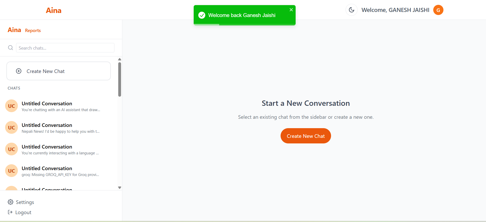
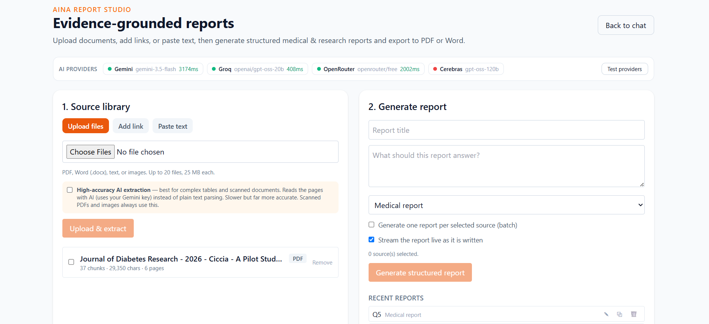
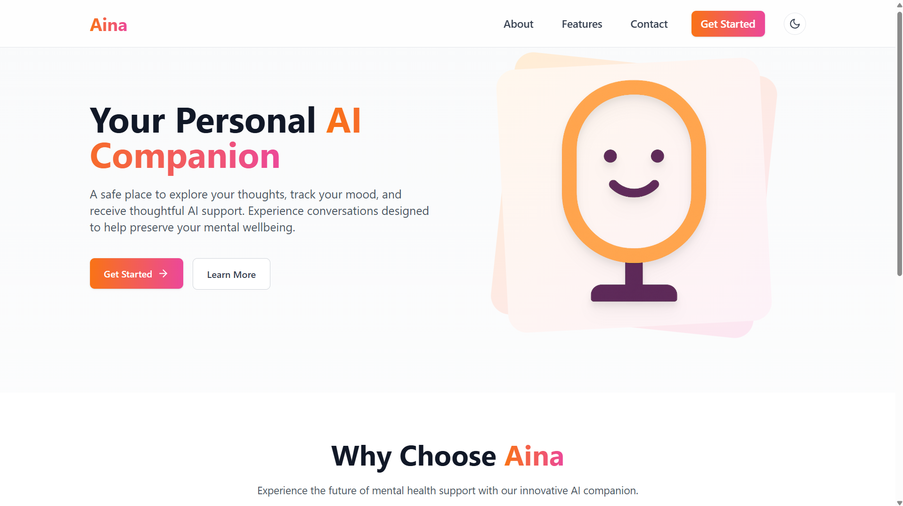
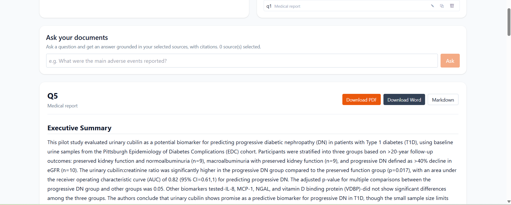

# AINA — Evidence-Grounded AI Report Studio & Wellness Companion

[](https://github.com/ganesh-234/AINA/actions/workflows/ci.yml)
[](LICENSE)

AINA is a full-stack MERN application with two connected experiences:

- **AINA Chat** — a supportive, non-medical wellness companion with saved conversations, response controls, speech input, and read-aloud support.
- **AINA Report Studio** — an evidence-grounded reporting workflow that turns user-provided documents into cited medical, research, literature, executive, or general reports.

The project is designed around a practical question: *how can an AI application produce useful long-form work while keeping its claims traceable to the source material?* AINA answers this with structured document ingestion, adaptive RAG, prompt chaining, citations, verification, and a resilient multi-provider model layer.

> **Important:** AINA is an analytical and supportive tool, not a diagnostic, treatment, or crisis service. Reports summarize the supplied evidence; they are not medical advice. Clinical decisions should be made with qualified professionals.

## At a glance

| Area | What AINA provides |
| --- | --- |
| Evidence workflow | Upload documents, import public articles/PDFs, or paste notes; select sources; generate a structured report; review citations; export the result. |
| RAG | Adaptive full-document context for smaller source sets and semantic retrieval for larger corpora, with keyword fallback if embeddings are unavailable. |
| Report quality | Medical, research, literature, executive, and general templates; evidence brief → draft → verification chain; inline `[Source N]` citations linked to stored evidence excerpts. |
| Model resilience | Gemini-first routing for reports, Groq for fast chat, OpenRouter/Cerebras fallbacks, retries, live provider health, and streaming. |
| Product polish | Authenticated per-user workspaces, report history, batch generation, Markdown/PDF/Word export, dark mode, and accessibility controls. |

## Screenshots

| Wellness companion | Evidence-grounded Report Studio |
| --- | --- |
|  |  |

| Landing experience | Generated clinical report |
| --- | --- |
|  |  |

## Report Studio workflow

```text
Source material
  PDF · DOCX · TXT · image · pasted notes · public article/PDF URL
       │
       ▼
Extract + normalize + classify
  PDF/DOCX parsing · optional Gemini OCR/table enrichment · document sections
       │
       ▼
Chunk + embed
  Gemini/OpenRouter embeddings · provenance retained per chunk
       │
       ▼
Adaptive evidence selection
  Full context for small inputs ── or ── semantic RAG for large inputs
       │
       ▼
Prompt chain
  Evidence brief → structured draft → optional evidence verification
       │
       ▼
Cited report
  Streamed preview · report history · Markdown / PDF / DOCX / HTML export
```

## Key capabilities

### Evidence-grounded reports

- **Multi-format source library:** PDFs, DOCX files, plain text, images, pasted notes, and public article or PDF links.
- **Robust document extraction:** `pdf-parse` and Mammoth handle digital files; optional Gemini vision extraction supports scanned documents and cleaner table reconstruction.
- **Document intelligence:** sources are classified and stored with structured sections, metadata, evidence candidates, chunk/page provenance, and optional embeddings.
- **Adaptive RAG:** AINA sends all source material when it fits the context budget; otherwise it retrieves semantically relevant chunks using cosine similarity. Keyword retrieval is a reliable fallback.
- **Traceable answers:** “Ask your documents” answers questions only from selected sources and returns evidence snippets.
- **Inspectable citations:** every new report stores the source, chunk, page, section, and excerpt supplied for each `[Source N]` label. Selecting a citation opens its evidence card in the report reader.
- **Purpose-built templates:**
  - Medical / clinical report — `Clinical Summary`, diagnostic results, clinical assessment, limitations, and clinical relevance.
  - Research paper analysis — methods, results, discussion, limitations, and implications.
  - Literature synthesis, executive brief, and general research report.
- **Quality chain:** an optional analyze → draft → verify workflow first extracts a fact-focused evidence brief, then drafts the report, then runs a best-effort grounding pass to remove or soften unsupported statements.
- **Delivery tools:** live streaming, per-source batch generation, saved report history, duplicate/rename/delete actions, and PDF, DOCX, HTML, or Markdown export.

### Multi-provider AI runtime

AINA uses a configurable OpenAI-compatible provider abstraction instead of binding the product to one model vendor.

- **Gemini** is preferred for long-context, evidence-grounded reports and is also used for embeddings and optional document vision extraction.
- **Groq** serves fast chat and streamed responses.
- **OpenRouter** and **Cerebras** can be configured as fallbacks.
- The router records latency and failure statistics, retries temporary `429`/`503` responses, chooses providers by workload, and fails over before returning a local fallback.
- The Report Studio includes a live health panel so users can see configured providers, models, availability, and response latency.

All model names and provider keys are environment-configurable. The checked-in example contains placeholders only.

### Conversational wellness experience

- Authenticated conversations persisted per user with editable titles and protected API routes.
- Supportive, non-medical system instructions and a visible safety disclaimer.
- Stop an in-flight request, pause/resume the visible response, or immediately reveal the full response.
- Browser speech-to-text input, text-to-speech read-aloud controls, theme support, and accessibility preferences.

### Security and reliability

- Password hashing with bcrypt, JWT authentication, optional Google OAuth 2.0, and owner-scoped MongoDB queries.
- Helmet headers, controlled CORS, central error handling, health endpoint, request logging, and global/per-feature rate limits.
- URL source ingestion accepts only public HTTP(S) addresses, blocks local/private network targets and unsafe redirects, limits redirects, and caps downloaded response size.
- Bounded in-memory uploads with file count, individual size, aggregate size, and upload-rate limits.
- Local secrets (`.env`, `.env.local`, API keys, and service backups) are excluded by `.gitignore`; only [`backend/.env.example`](backend/.env.example) is versioned.

## Architecture

```text
┌─────────────────────────────────────────────────────────────────┐
│ React 19 + Vite                                                   │
│ Chat · Report Studio · Redux auth state · accessible controls    │
└───────────────────────────────┬─────────────────────────────────┘
                                │ HTTPS / REST + JWT
┌───────────────────────────────▼─────────────────────────────────┐
│ Express 5 API                                                     │
│ Auth · Chat · Source library · RAG · Reports · Exports           │
├───────────────┬───────────────────────────────┬─────────────────┤
│ MongoDB       │ Document pipeline             │ Model router    │
│ users         │ parse → classify → chunk      │ Gemini          │
│ conversations │ embed → retrieve → cite       │ Groq            │
│ sources       │                               │ OpenRouter      │
│ reports       │                               │ Cerebras        │
└───────────────┴───────────────────────────────┴─────────────────┘
```

## Tech stack

| Layer | Tools |
| --- | --- |
| Frontend | React 19, Vite, Tailwind CSS, Redux Toolkit, React Router, Axios, Framer Motion, marked, DOMPurify |
| Backend | Node.js, Express 5, Mongoose, JWT, Passport, bcrypt, Helmet, express-rate-limit, Morgan, Multer |
| AI and retrieval | Google Gemini, Groq, OpenRouter, Cerebras; Gemini/OpenRouter embeddings; cosine-similarity RAG |
| Document/report tooling | pdf-parse, Mammoth, JSDOM + Readability, pdfmake, html-to-docx |
| Delivery | Docker Compose, GitHub Actions CI |

## Run locally

### Prerequisites

- Node.js 18+ and npm
- MongoDB (local or Atlas)
- At least one AI provider key — Gemini is the recommended report provider

### 1. Install dependencies

```bash
git clone https://github.com/ganesh-234/AINA.git
cd AINA

cd backend && npm install
cd ../frontend && npm install
```

### 2. Configure local environment variables

```bash
cd backend
cp .env.example .env.local
```

Set your own MongoDB connection string, strong JWT/session secrets, and at least one provider key in `backend/.env.local`.

```env
MONGO_URI=your_mongodb_connection_string
JWT_SECRET=replace_with_a_long_random_value
SESSION_SECRET=replace_with_a_different_long_random_value
CLIENT_ORIGIN=http://localhost:5173

LLM_POOL=gemini,groq,openrouter,cerebras
REPORT_PREFER_PROVIDER=gemini

GEMINI_API_KEY=your_gemini_key
GEMINI_MODEL=gemini-3.6-flash
GROQ_API_KEY=your_groq_key
GROQ_MODEL=openai/gpt-oss-20b
```

Optional providers, embedding settings, upload safeguards, and Google OAuth placeholders are documented in [`backend/.env.example`](backend/.env.example).

Create `frontend/.env.local`:

```env
VITE_SERVER_URL=http://localhost:5000
```

> Do not commit `.env.local` files. They are intentionally ignored.

### 3. Start the application

```bash
# Terminal 1 — API, on http://localhost:5000
cd backend && npm start

# Terminal 2 — web app, on http://localhost:5173
cd frontend && npm run dev
```

Open `http://localhost:5173`. Report Studio is available at `/reports` after sign-in.

### Docker option

The repository also includes Dockerfiles and `docker-compose.yml` for the frontend and backend. Copy `backend/.env.example` to `backend/.env.local`, populate it locally, then run:

```bash
docker compose up --build
```

The Compose file is set up to reach a local MongoDB instance through `host.docker.internal`; adjust `MONGO_URI`, ports, and `CLIENT_ORIGIN` for your environment.

## Verification

```bash
# Backend document-intelligence and unit checks
cd backend && npm test

# Frontend static checks and production build
cd frontend && npm run lint && npm run build
```

GitHub Actions runs the backend tests and frontend production build on pushes to `main` and pull requests.

## Repository layout

```text
AINA/
├── backend/
│   ├── controllers/       # auth, chat, and Report Studio workflows
│   ├── models/            # User, Conversation, Source, Report
│   ├── routes/            # authenticated API endpoints
│   ├── services/          # LLM routing, RAG, extraction, exports, templates
│   └── tests/             # document intelligence and unit checks
├── frontend/src/
│   ├── components/        # chat, accessibility, navigation, UI
│   ├── hooks/             # speech recognition and text-to-speech
│   ├── pages/             # Chat and Report Studio experiences
│   └── store/             # Redux auth state
├── docs/screenshots/      # repository screenshots
└── docker-compose.yml
```

## Engineering decisions

- **Grounding before generation:** source selection and a fact-first evidence brief reduce the chance that report content drifts away from the supplied material.
- **Graceful degradation:** failed embedding calls fall back to keyword retrieval; failed secondary prompt-chain steps preserve the best valid draft; model calls fail over across configured providers.
- **Honest medical positioning:** the UI and prompts frame reports as evidence summaries, not diagnoses or treatment plans.
- **Secure-by-default ingestion:** fetching arbitrary URLs and buffering arbitrary uploads are common application risks, so the project explicitly limits both.
- **Testable services:** deterministic document intelligence is kept separate from model calls, enabling local tests without an AI key.

## Future improvements

- Citation-level source highlighting in the report reader
- Evaluation dataset for grounding, citation accuracy, and report-quality regression tests
- Optional re-ranking and hybrid retrieval tuning
- Background jobs/queues for very large batch workloads
- Deployment configuration for managed MongoDB and production secret storage

## License

Released under the [MIT License](LICENSE). © 2026 Ganesh Jaishi.
